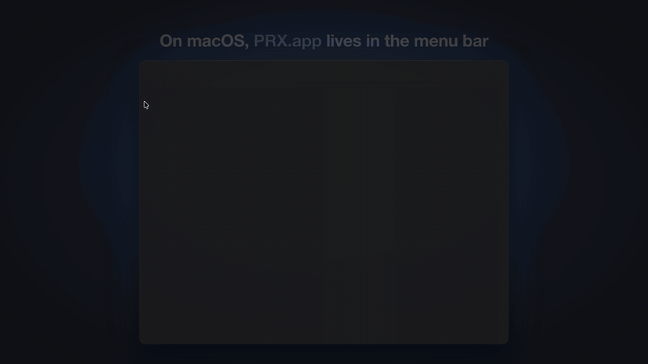
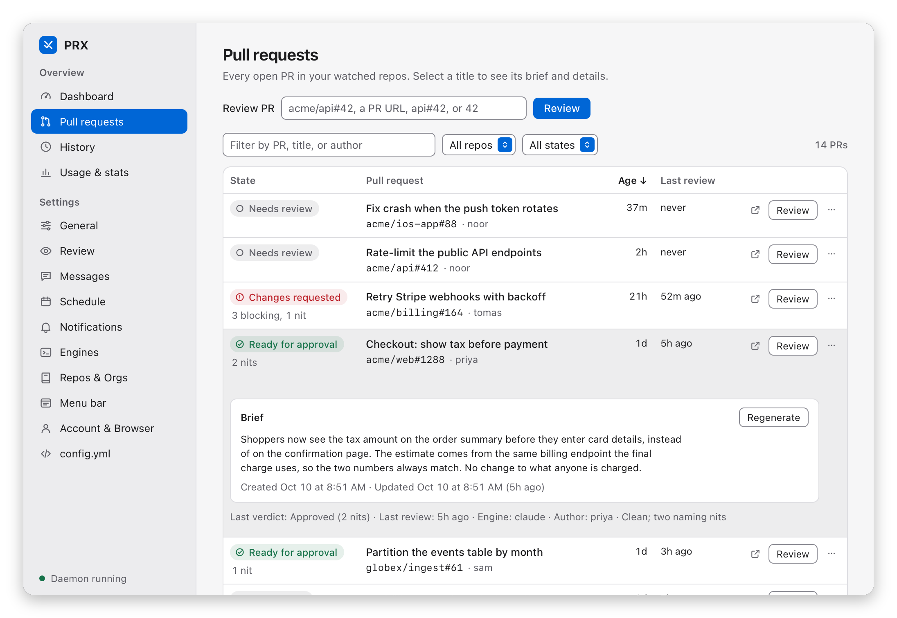
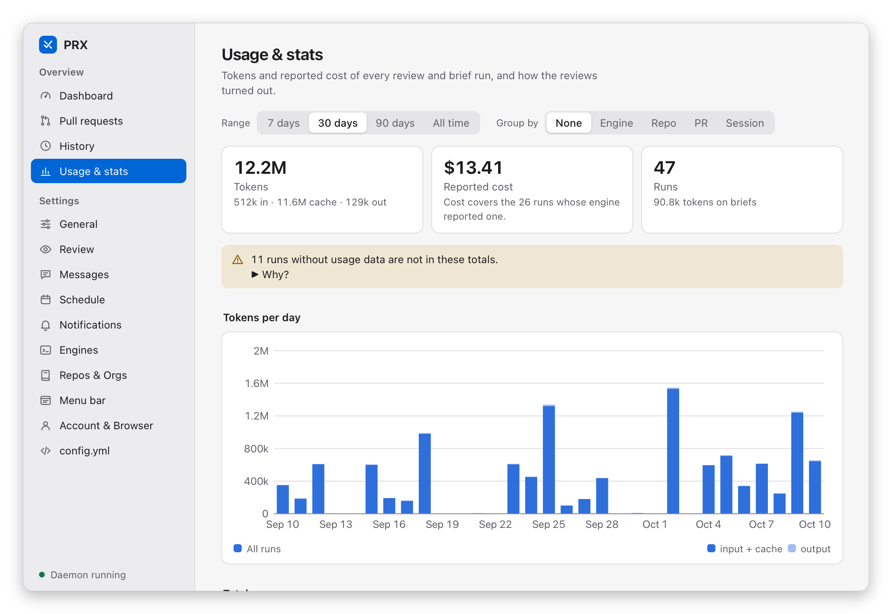
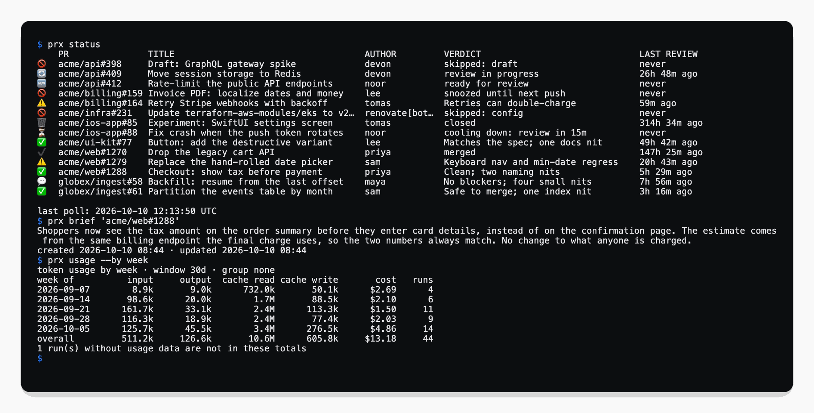

<p align="center">
  <picture>
    <source media="(prefers-color-scheme: dark)" srcset="docs/media/logo-dark.png">
    <source media="(prefers-color-scheme: light)" srcset="docs/media/logo-light.png">
    
  </picture>
</p>

<h1 align="center">prx</h1>

**prx** (Pull Request eXaminer) has the coding agent you already run review your pull requests,
and leaves the approving to you. It watches the GitHub repositories you choose, has a local agent
CLI (`pi`, `claude`, `codex`, or your own) or an LLM API review each open pull request, posts the
findings to GitHub itself, notifies you, and keeps a history of every review.

It runs on your machine as one Rust binary: a CLI, a background daemon, and a localhost API. On
macOS there is also PRX.app, a menu bar client. The only services it talks to are GitHub, through
the `gh` CLI you are already signed in to, and an LLM endpoint if you configure one.

<p align="center">
  <a href="docs/media/demo.mp4"></a>
  <br>
  <sub>23 seconds of prx: the menu bar menu, then the app window. The <a href="docs/media/demo.mp4">full demo</a> runs 109 seconds (MP4, 1080p) and also shows a pull request's actions and an approval from the menu.</sub>
</p>

## Why

An agent that can post to GitHub can also approve a pull request, merge it, or follow instructions
hidden in a diff. prx is built so the reviewing agent never needs to write anything to GitHub, by
splitting the work in three:

1. **The agent only reads.** It analyzes the pull request and writes one JSON file, the review
   manifest: a verdict, a summary, and a list of findings. It is told never to write to GitHub
   and to treat everything in the PR as untrusted data.
2. **prx does the writing.** It validates the manifest, then posts the review body and inline
   comments through `gh`. prx itself never executes anything from the PR.
3. **Only a human approves.** prx has one approve path: you, running `prx approve` or clicking
   *Approve…* in the app.

One limit to know about: an agent CLI runs as you, so its read-only rule is an instruction in the
prompt, not a sandbox. An LLM API engine has no tools at all; it only receives the prompt and the
diff. The [security model](docs/concepts/security.md) has the details.

```
prx daemon ──poll──> gh pr list ──> lifecycle state machine ──> desktop notifications
    │                                                     │
    │ render prompt + run agent                           state.json / history.jsonl
    v                                                     │
read-only agent ──writes──> review manifest (JSON)        └──> localhost IPC API
                             │                                  ^           ^
                    prx validates & posts                        │           │
                             v                                   │           │
              gh api (inline) + gh pr review (body)        CLI commands   menu bar client
                             ^                                           (separate GUI)
                    prx approve (human only)
```

More in [Architecture](docs/concepts/architecture.md).

## Screenshots

Everything shown here is a made-up team (`acme`, `globex`), not real repositories.

PRX.app lives in the macOS menu bar, and its menu is where you will use it most: your pull
requests grouped by state, with review and approve actions one click away.

<p align="center">
  
</p>

Each pull request opens a submenu with the verdict, a one-line brief, and every action: *Review*,
*Approve…*, *Block (request changes)…*, *Snooze*, *Ignore*
([screenshot](docs/media/screenshots/menu-pr-actions.png)). Approving always asks first. The
[PRX.app guide](docs/guides/prx-app.md#the-menu) walks through the menu.

The Dashboard in PRX.app: what needs you, with a plain-language brief of each pull request.

<p align="center">
  <picture>
    <source media="(prefers-color-scheme: dark)" srcset="docs/media/screenshots/overview-dark.png">
    
  </picture>
</p>

<table>
  <tr>
    <td width="50%" valign="top">
      <picture>
        <source media="(prefers-color-scheme: dark)" srcset="docs/media/screenshots/prs-dark.png">
        
      </picture>
    </td>
    <td width="50%" valign="top">
      <picture>
        <source media="(prefers-color-scheme: dark)" srcset="docs/media/screenshots/usage-dark.png">
        
      </picture>
    </td>
  </tr>
  <tr>
    <td valign="top">Every pull request with the agent's verdict, and its brief one click away.</td>
    <td valign="top">Tokens and reported cost per day, engine, repository, or pull request.</td>
  </tr>
</table>

The same data from the command line:

<p align="center">
  
</p>

More screenshots are in the guides, starting with [PRX.app](docs/guides/prx-app.md).

## Install

You need the [GitHub CLI](https://cli.github.com/) signed in (`gh auth status`), and either a
coding-agent CLI or an API key for an LLM API.

**From source**, with a stable Rust toolchain:

```bash
git clone https://github.com/vs4vijay/prx
cd prx
cargo install --path .         # the prx CLI and daemon
scripts/bundle-macos.sh        # macOS only: build PRX.app and install it to ~/Applications
```

**Prebuilt.** Tagged versions are published on the
[releases page](https://github.com/vs4vijay/prx/releases) with CLI tarballs for macOS and Linux
(arm64 and x86_64), a `PRX.app` zip for Apple silicon, and `SHA256SUMS`. If no release is listed
there yet, build from source.

PRX.app is ad-hoc signed and not notarized; a downloaded copy needs its quarantine flag cleared
once. Details for every platform are in [Install](docs/getting-started/install.md).

## Quickstart

```bash
prx init                            # write ~/.config/prx/config.yml
prx repos add acme/api              # watch a repository
prx doctor                          # check config, gh auth, engines, data directory
prx status                          # list open PRs and their state
prx review acme/api#42 --dry-run    # run the whole pipeline and print it; posts nothing
prx review acme/api#42              # review one PR now and post the result
prx daemon start                    # keep going in the background: polling, queue, notifications
```

Then act on what the review found:

```bash
prx approve acme/api#42             # post your own GitHub approval
prx snooze acme/api#42 --hours 2    # or: prx ignore, prx pause --hours 2
prx history                         # what was reviewed, merged, or failed
prx insights                        # throughput, recurring blockers, effectiveness
```

On macOS, `open ~/Applications/PRX.app` starts the daemon for you and puts the same controls in the
menu bar. The [Quickstart](docs/getting-started/quickstart.md) and
[Your first review](docs/getting-started/first-review.md) go through this step by step.

## Features

- **Review lifecycle.** A state machine per PR with cooldowns before a first review and between
  re-reviews, skip rules for drafts, authors, labels, and branches, snooze, ignore, and diff-size
  caps.
- **Three review modes.** Review and post comments, review without posting (`monitor`), or `off`.
  Set globally, per organization, or per repository.
- **Your choice of engine.** Built-in support for the `pi`, `claude`, and `codex` CLIs, any other
  agent CLI through config, or the Anthropic, OpenAI, and OpenAI-compatible APIs (including local
  servers such as Ollama). Agents that support it resume the same session on re-reviews.
- **Scheduling and pausing.** Cron expressions limit when reviews run; a timed pause holds
  automatic reviews during a demo or a release freeze.
- **Control over what is posted.** Custom review prompts, a template for the review body, inline
  comments on or off, and a fixed output contract that no prompt edit can remove.
- **Briefs.** A short plain-language description of what each PR does, for people who have not
  opened the diff.
- **History, insights, and token usage.** An append-only local log, analytics on recurring
  blockers and review effectiveness, and per-engine token and cost reports.
- **Desktop notifications** with configurable tiers per event.
- **PRX.app for macOS.** A menu bar item with per-PR actions, and a window with a dashboard,
  history, usage charts, and settings.
- **Localhost API.** The CLI and the app are thin clients of the daemon's bearer-token JSON API,
  which you can script against too.
- **Live config reload** and login autostart through launchd or systemd.

## Documentation

Everything is under [docs/](docs/README.md).

| Section | Start with |
|---------|------------|
| Getting started | [Install](docs/getting-started/install.md), [Quickstart](docs/getting-started/quickstart.md), [Your first review](docs/getting-started/first-review.md) |
| Guides | [Review modes](docs/guides/review-modes.md), [Schedule](docs/guides/schedule.md), [Pausing](docs/guides/pausing.md), [Prompts](docs/guides/prompts.md), [Commentary](docs/guides/commentary.md), [Briefs](docs/guides/briefs.md), [Engines](docs/guides/engines.md), [Token usage](docs/guides/token-usage.md), [Insights](docs/guides/insights.md), [Notifications](docs/guides/notifications.md), [Autostart](docs/guides/autostart.md), [PRX.app](docs/guides/prx-app.md) |
| Reference | [Configuration](docs/reference/configuration.md), [CLI](docs/reference/cli.md), [Environment variables](docs/reference/environment.md), [IPC API](docs/reference/ipc-api.md), [Review manifest](docs/reference/review-manifest.md), [Data files](docs/reference/data-files.md) |
| Concepts | [Architecture](docs/concepts/architecture.md), [Security model](docs/concepts/security.md), [Scope](docs/concepts/scope.md) |
| Help | [Troubleshooting](docs/troubleshooting.md) |

## Security

- **No stored credentials.** Every GitHub call goes through your `gh` session. LLM API keys and
  alternate GitHub tokens are referenced by environment-variable name and never written to disk.
- **Local only.** The API listens on `127.0.0.1` behind a per-start bearer token. State and history
  stay on your disk. There is no telemetry. The one optional outbound connection is to an LLM API
  you configure, which then receives the review prompt and the PR diff.
- **No automated approval.** No code path in prx lets an engine approve; PR content is handled as
  data.

See the [security model](docs/concepts/security.md). To report a vulnerability, follow
[SECURITY.md](SECURITY.md).

## Scope

prx is a review manager for one person's machine. It does not merge pull requests, approve them,
or run in CI, and it has no team or hosted features. Priority ordering beyond oldest-due-first,
delta reviews, file-path filters, and exports are also out of scope for now. See
[Scope and non-goals](docs/concepts/scope.md).

GitHub is the only supported forge. PRX.app is macOS only; the CLI and daemon run on macOS and
Linux.

## Contributing

Bug reports and pull requests are welcome. [CONTRIBUTING.md](CONTRIBUTING.md) has the setup and
the checks to run before you push; [AGENTS.md](AGENTS.md) has the project's invariants and
conventions, for people and coding agents alike; [Development](docs/development.md) covers the
test tiers, the release process, and how the screenshots and the demo video are regenerated.

## License

[MIT](LICENSE)
