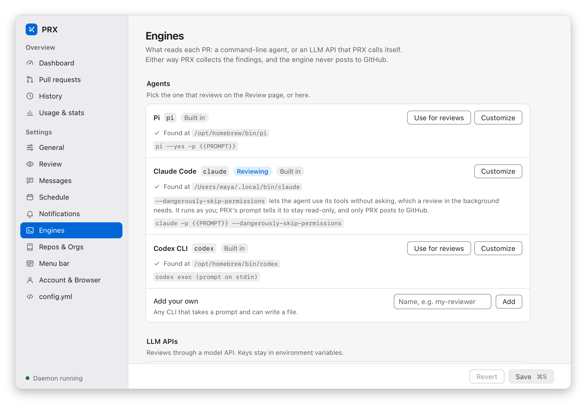

# Engines

An **engine** is what performs a review. Every `engines:` entry has a `type`:

- **`agent`** — a local coding-agent CLI that prx spawns read-only. Built-ins: `pi`, `claude`,
  `codex` (an entry with the same name overrides the built-in).
- **`llm_api`** — prx calls an LLM HTTP API itself: it fetches the diff (under the same
  `diff_max_*` caps), sends the rendered review prompt with the diff appended, extracts the
  manifest JSON from the reply (raw or in a ```` ```json ```` fence), and runs the same strict
  validation, retry-once, posting, state, and history as an agent review.

`engine` selects one at defaults / org / repo (most specific wins); `brief.engine` may
name a different one.



```yaml
defaults:
  engine: claude
  agent_model: opus                      # agent engines only
engines:
  pi:                                    # override a built-in: absolute path for autostart
    type: agent
    command: /Users/you/.bun/bin/pi
    args: ["--yes", "-p", "{{PROMPT}}"]
    model_args: ["--model", "{{MODEL}}"]
  haiku:                                 # Anthropic Messages API
    type: llm_api
    provider: anthropic                  # base_url defaults to https://api.anthropic.com
    model: claude-haiku-4-5
    api_key_env: ANTHROPIC_API_KEY       # the variable's NAME — never the key
    max_tokens: 4000
  gpt:                                   # OpenAI Chat Completions
    type: llm_api
    provider: openai                     # base_url defaults to https://api.openai.com/v1
    model: gpt-5
    api_key_env: OPENAI_API_KEY
    temperature: 0.2
  local:                                 # any OpenAI-compatible server (Ollama, vLLM, LiteLLM, a gateway…)
    type: llm_api
    provider: openai_compatible
    base_url: http://localhost:11434/v1  # required; prx POSTs to <base_url>/chat/completions
    model: qwen2.5-coder:32b
    api_key_env: OLLAMA_API_KEY          # must still name a variable; any value works for keyless servers
  omp:                                   # a custom agent CLI (omp / opencode style)
    type: agent
    command: omp
    args: ["-p", "{{PROMPT}}"]
    model_args: ["--model", "{{MODEL}}"]
    session_output:
      stdout_prefix: "prx-session:"      # the agent prints `prx-session: <id>`
    resume_args: ["--resume", "{{SESSION_ID}}"]
orgs:
  - org: acme
    engine: gpt
repos:
  - name: acme/api
    engine: local                        # repo beats org beats defaults
```

The `omp` entry is an illustration of the shape — prx ships no `omp`/`opencode` built-ins; check
your CLI's own non-interactive and resume flags. Base URLs: Anthropic's is the host
(prx appends `/v1/messages`); OpenAI and OpenAI-compatible ones include the version path (prx
appends `/chat/completions`).

## Agent contract

When `args` contains a bare `-`, prx pipes the rendered prompt to the agent's
stdin; otherwise `{{PROMPT}}` is substituted into the argv (an argv with neither is rejected — the
agent would never receive its instructions). The prompt carries `{{PR_NUMBER}}`, `{{REPO}}` and
`{{MANIFEST_PATH}}`; the path is also exported as the `PRX_MANIFEST_PATH` environment variable.
prx always appends its output contract, which tells the agent to write the manifest to that path.

## Prompt placement

Both engine types get the same prompt, assembled as described in
[Prompts](prompts.md): the rendered `review_prompt` → `extra_prompt` (under "Additional
instructions") → any one-off per-run text (`prx review --prompt`, the menu's *Review with prompt…*)
→ the output contract. An `llm_api` engine also gets the PR diff, inserted as a fenced, explicitly
untrusted section just before the output contract (so the contract stays last), plus a fixed system
prompt telling it to reply with the manifest JSON instead of fetching or writing files.

## Same-session re-reviews

An agent engine with `resume_args` keeps the PR's session across
re-reviews, so the reviewer sees its own earlier review of that PR. Each run reports its session
id — via a `prx-session: <id>` stdout line (the default, or your own `stdout_prefix`), or a field
of the agent's JSON output (`json_field`) — and the next review appends `resume_args` with
`{{SESSION_ID}}` filled in. The built-ins run in JSON output mode to make this work: `claude` adds
`--output-format json` (`json_field: session_id`, resume with `--resume {{SESSION_ID}}`), and
`codex` runs `exec --json -` (`json_field: thread_id`, resume with `exec … resume {{SESSION_ID}}`).
`pi` has no resume. If a resumed run fails for any reason (an expired or oversized session, say),
prx retries **immediately as a fresh session in the same attempt** — a broken session never fails
a review on its own. Engines without `resume_args` behave as before: the session is cleared when a
re-review is triggered. `llm_api` engines are stateless; `session_output`/`resume_args` on them is
a validation error.

## Validation

Loading rejects: an `engine` / `brief.engine` that names nothing; an
agent argv with neither `-` nor `{{PROMPT}}`; `resume_args` without `{{SESSION_ID}}`; an
`llm_api` entry without `model` or `api_key_env`, with an `api_key_env` that isn't a variable name
(e.g. a pasted `sk-…` key), with any inline key field (`api_key`, `token`, `secret`, …), or with
`provider: openai_compatible` and no `base_url`. A missing key *variable* is not a load error (the
key is read at call time): `prx doctor` warns about it, and a review then retries once and fails
cleanly, naming the variable.

## The daemon's environment

The key is read from the **daemon's** environment, per call. Export
it where the daemon starts — for a [login autostart](autostart.md), launchd/systemd do not read your
shell profile, so a variable set only in `~/.zshrc` is invisible to the daemon (`prx doctor`, run
from your shell, can't detect that).

## Legacy `agents` / `agent` keys

Configs written before engines keep working unchanged: the
`agents:` map is read as `type: agent` entries, and `agent` (at defaults, org, or repo level) as
`engine`; if both forms appear at one level the new one wins with a logged warning. `prx config
show` and `GET /config` present the `engines`/`engine` form, and **any rewrite of the file** —
`prx config set`, `prx repos add/remove`, a settings-app save — writes it back in that form. Binaries
older than this change cannot read an `engines:` config, so **back up `config.yml` before the first
save** if you might roll back:

```bash
cp ~/.config/prx/config.yml ~/.config/prx/config.yml.pre-engines
```
