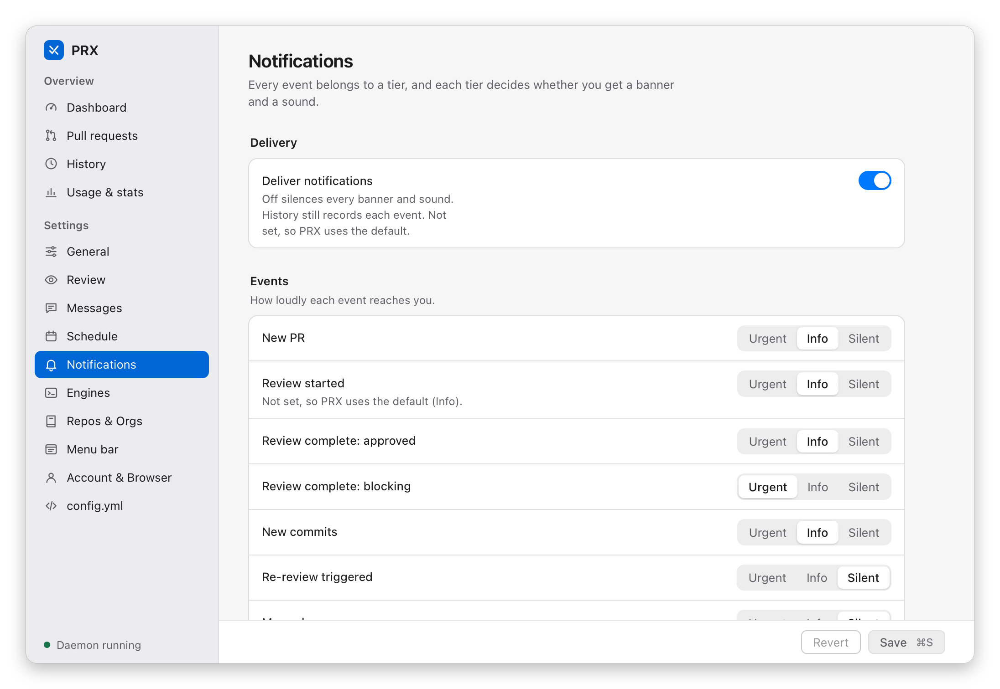

# Notifications

prx raises desktop notifications for lifecycle events. Each event maps to a tier, and each tier
decides whether a banner and a sound are used. The event list, default tiers, and the master
switch are in the [configuration reference](../reference/configuration.md#notification-events-and-tiers).

## From the daemon

Delivery is best-effort (`osascript` on macOS, `notify-send` on Linux) and never fatal.
Per-org and per-repo `notifications.*` overrides decide the tier of that repo's events.

## From PRX.app

The shell raises native macOS banners for *new* history events whose tier has
`banner: true` — the same event → tier config the daemon reads (`silent`-tier events, such as
merges and closes by default, never banner; on cold start the existing history is marked seen, not
re-bannered). The daemon also banners these events itself, but duplicates are resolved
automatically: the shell identifies itself on every IPC request
(`X-Prx-Client: menubar/<version>`), and the daemon suppresses its own banners while a menubar has
been seen within the last 90 s (≈ 9 missed 10 s polls), resuming banner delivery by itself once no
menubar answers for that window. `notification_tiers.<tier>.banner: false` in `config.yml` remains
the manual override — it silences the tier on both sides regardless. This applies to
`on_review_started` too: a review start is a `review_started` history entry for the shell and a
daemon notification at the same moment, deduplicated the same way, so if you still see doubled
"review started" banners (e.g. a menubar older than the daemon), set that event's tier to one with
`banner: false` or to `silent`. The shell also honors the global `defaults.notifications.enabled`
master switch: while it is `false` neither side raises anything.

Run as PRX.app, the shell posts its banners through the macOS notification center, so they come
from **PRX** (with its icon) and clicking one opens the PR in the repo's browser. macOS asks once
whether PRX may send notifications; you can change the answer later in System Settings →
Notifications → PRX, and it applies to the next banner. If you choose *Don't Allow*, PRX shows no
banners at all (the daemon stays quiet too while the app runs), but the menu and window still show
every state. Until you answer, or when macOS will not authorize the bundle (an ad-hoc build run
from outside an Applications folder) or you run the bare `prx-menubar` binary, banners use the
older path: [`terminal-notifier`](https://github.com/julienXX/terminal-notifier) when installed
(click opens the PR), else plain `osascript` (no click action).
