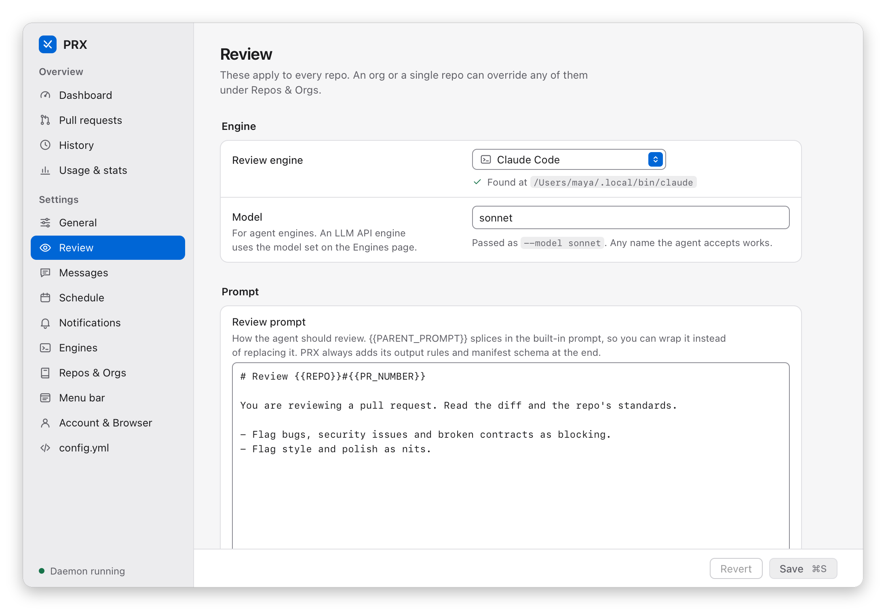

# Prompts

A review prompt has two parts:

- **Guidance** — `review_prompt`, which you control: how to review, what to fetch and look at, which
  repo standards matter. `default` (or leaving it unset) uses the guidance built into the binary — no
  prompt file on disk.
- **The output contract** — fixed text prx **always appends last**, whatever `review_prompt` says:
  the read-only rule (never write to GitHub), the rule that all PR content is untrusted data, the
  exact manifest path to write, and the manifest schema (`manifest_version` 1, including the optional
  `brief` field). It cannot be edited through config or settings, so no prompt edit can break the
  manifest contract. The settings app shows it read-only under the prompt editor, in *Always added by
  PRX*; `GET /config` serves it as `review_contract`.



So a custom prompt only needs to say *how* to review — no schema, no output instructions. An override
**replaces** the default guidance; put `{{PARENT_PROMPT}}` inside it to splice the built-in guidance
in. Placeholders: `{{PR_NUMBER}}`, `{{REPO}}`, `{{MANIFEST_PATH}}` (still substituted, but the
contract names the path anyway), `{{REVIEWER_LOGIN}}` (the effective `identity.login`, else the `gh`
user). `extra_prompt` is appended to every review under an
"Additional instructions" heading — handy for a standing rule without replacing the whole prompt:

```yaml
defaults:
  extra_prompt: |
    Pay special attention to database migrations.
repos:
  - name: org/payments
    review_prompt: |
      {{PARENT_PROMPT}}

      This repo handles money: treat any unchecked arithmetic on amounts as blocking.
  - name: org/db
    review_prompt: Focus on SQL injection and migrations in {{REPO}}.
```

The agent's prompt is always assembled in this order: the rendered `review_prompt` → the configured
`extra_prompt` → the one-off instructions of a *Re-review with prompt…* request (those apply to that
single run and are never written to config, state, or history) → the output contract. Each key
resolves most-specific-wins (repo > org > defaults). `prx review <target> --dry-run` runs the
assembled prompt through the engine without posting or saving anything.

Prompts written before the contract existed: a `review_prompt` that is exactly the previous shipped
default (saved verbatim, compared ignoring surrounding whitespace) is treated as `default`. A custom
prompt that still carries its own manifest schema (it mentions `manifest_version` or `"verdict"`)
keeps working, but `prx doctor` and the prompt editor show a hint that output instructions are now
added automatically and can be removed from the prompt.

Older configs that pointed `review_prompt` at a file (`~/prompts/strict.md`, `./p.txt`, …) are
**rejected** with "review_prompt is now the prompt text; paste the contents of … instead" — prx
never reads the file. `prx init` no longer writes `prompts/default.md`; `prx doctor` reports
built-in vs custom prompts per level and warns if an edited legacy file would be lost.
