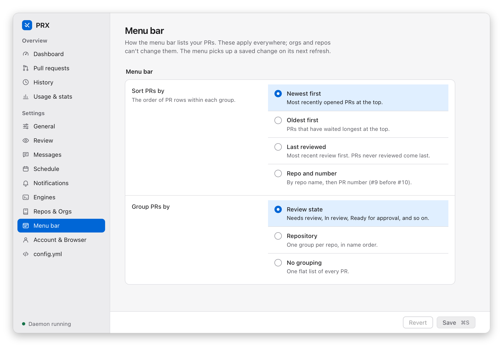
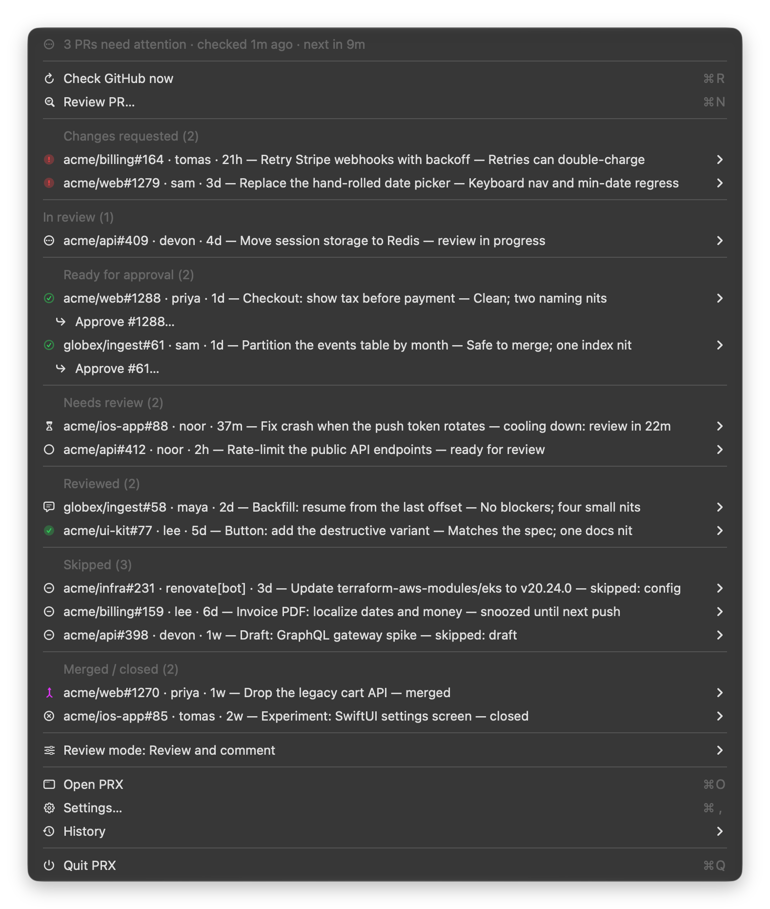
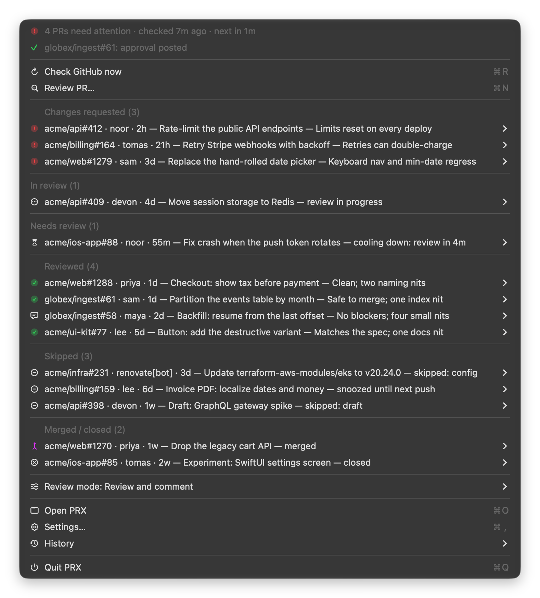
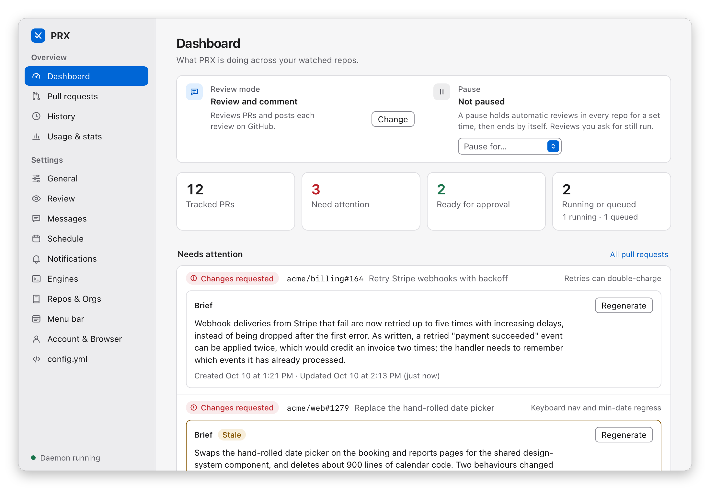
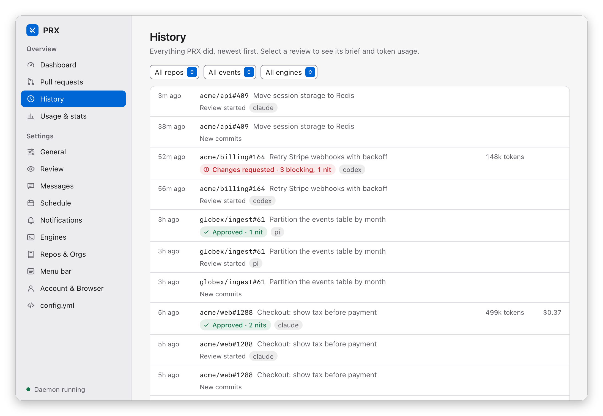
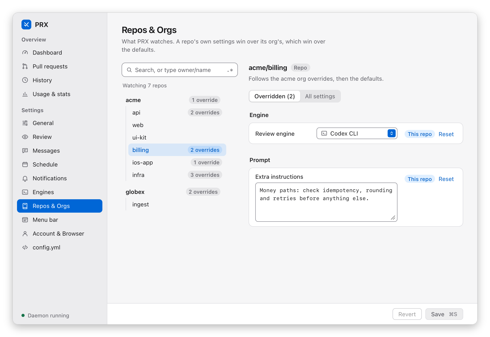

# PRX.app user guide (macOS)

PRX.app is the macOS client: a menu bar item that mirrors the daemon's view of your pull requests,
plus a window with a dashboard, history, usage, and settings. It contains the CLI and the daemon,
so it is also a complete install. Everything it does goes through the daemon; the app never calls
`gh` or GitHub itself. For how it is built, see [PRX.app internals](../concepts/prx-app-internals.md).

The menu is described under [The menu](#the-menu) and the window under
[The PRX window](#the-prx-window). The screenshots on this page show a made-up team, not real
repositories.

## Install

See [Install](../getting-started/install.md#prxapp-macos): download the release zip (in a browser
or with `gh`), put `PRX.app` in Applications, and
[clear the quarantine flag](../getting-started/install.md#step-2-allow-it-to-open) before the
first open, or macOS refuses to open it. Then open it; there is no other setup. On a first launch
with no config file the app (v0.1.1 or later) writes the default config itself, the same one
`prx init` writes, and the Dashboard offers *Add a repo*. After the first launch, Settings →
General offers *Open at login* and *Install command-line tool…*. To build the app yourself, see
[Building from source](../development.md#building-from-source).

## Launching

PRX is single-instance. Opening it (Finder, Spotlight, Dock, `open`) shows the
window on the Dashboard; opening it again while it runs brings the running instance forward
instead of starting another (a bare second launch posts `com.prx.app.open-window` to the running
app and exits). The login item launches it with `--background`: menu bar item and daemon, no
window. (`--settings`, from the old standalone settings window, now just opens the window on
*General*.)

## Quitting

*Quit PRX* (menu footer, or ⌘Q in the app menu) quits the UI and gracefully stops a
daemon **the app started** (SIGTERM; in-flight reviews follow the daemon's normal shutdown). Hold
**⌥** and the item becomes *Quit PRX (keep reviewing)*, which leaves that daemon running. A daemon
the app did not start (CLI, launchd) keeps running either way.

## The daemon

On launch the app attaches to a daemon that is already running, or starts one itself (creating
the default config first when there is no config file; an existing one is never touched) and
supervises it: a crashed daemon is restarted with a growing delay, and after 5 failures within 10
minutes the menu shows *Daemon stopped* with *Start daemon* and *Show daemon log*. The details are
in [PRX.app internals](../concepts/prx-app-internals.md#one-app-two-processes).

## Menu bar icon

A monochrome template glyph, the Verdict X (macOS tints it for light, dark and tinted menu
bars), rendered at 1x/2x/3x. States differ by shape, in precedence order: **offline** (dimmed mark
+ slashed ring — daemon unreachable; it reconnects automatically, since discovery re-reads
`daemon.port`/`daemon.token` on every poll), **paused / stopped** (pause bars — a pause, or review
mode `off`), **reviewing** (three dots — reviews in flight), **attention** (a solid dot), and
**idle** (the bare mark). The number of PRs needing attention (`reviewed_changes_requested` +
`in_review`) is the status item's **title**, beside the glyph in the menu bar's font — shown in
every online state, capped at `99+`, hidden offline; the tooltip says the state in words. See
`assets/menubar-glyph-states.png`.

## The menu

Rebuilt from a fresh `GET /status` + `GET /history` on every poll (~10 s, plus a re-read
whenever the icon is clicked or an action completes — so the menu needs no refresh item of its
own). Top to bottom, separated: the status header, quick actions, the PR groups, automatic
reviews, the app, and Quit. ⌘R, ⌘N, ⌘O, ⌘, and ⌘Q work while the menu is open. Every item image
is an SF Symbol; states use the app window's state system and colours (see *PR rows*).

The menu screenshots in this guide show the demo data (a made-up team, `acme` and `globex`) in
dark appearance; the menu follows the system appearance.

### Status header

One line: the headline (*All clear*, *2 PRs need attention*, *No PRs
tracked yet*, or *Reviews off*) with when PRX last checked GitHub and when it checks next, in
relative time (*2 PRs need attention · checked 2m ago · next in 13m*; while paused the
countdown takes the "next" slot: *· paused, 1h 12m left*). Its symbol follows the menu bar
glyph (paused, reviewing, attention, all clear). Hold ⌥ to turn it into the diagnostics line:
*PRX 1.1.0 · daemon 1.1.0 · pid 4242 · up 3h · 166 PRs · 1 reviewing · 0 queued*. A second line
appears only for something extra: the outcome of the last action, or a daemon health problem
with its fix — *config.yml not loaded: … — Open…* (opens the raw config) or *Daemon 1.0.0 is
running, app is 1.1.0 — Show log*.

### Quick actions

*Check GitHub now* ⌘R (`POST /review-now`: a config reload check, then an
immediate poll of every repo and the due-scan — nothing is enqueued while paused), *Review PR…*
⌘N (a panel taking any [target form](../reference/cli.md#prx-review) — `org/repo#N`, a URL, `repo#N`, `N`, `#N` —
plus the engine / post / prompt options; the daemon's error or note, such as the candidates of
an ambiguous number, is shown verbatim).

### Order and grouping

Order and grouping follow the global [`menu`](../reference/configuration.md#keys) settings (also on the settings
app's *Menu bar* page; a saved change applies on the next refresh, no restart). `menu.sort`
orders the rows within every group: `created_desc` (default — newest PR first), `created_asc`
(oldest first), `last_review_desc` (most recently reviewed first, never-reviewed last), or `key`
(repo, then PR number numerically). Ties and missing timestamps fall back to the `key` order.
`menu.group_by` picks the groups:
- `lifecycle` (default): *Changes requested*, *In review* (together: the attention count),
  *Ready for approval*, *Needs review*, *Reviewed*, *Skipped*, *Merged / closed*, in that order;
- `repo`: one group per repo, headed by its `org/repo`, in name order;
- `none`: one flat *Pull requests (N)* list.

With `repo` or `none`, the PRs the headline counts (changes requested, in review) are also
pinned in a *Needs attention (N)* group at the top, so they are never pages deep.

With `menu.group_by: none` and the default order, the same pull requests look like this:

Empty groups are omitted. *Ready for approval* holds PRs whose latest review verdict is
`approved` and that you haven't approved yet; in every grouping mode each such row is followed by
an *↳ Approve #n…* item (an arrow symbol under the row's state symbol, one level in, naming the
PR's number) (the same human-only approve path, with the same
confirmation). These PRs don't raise
the attention count. Once you approve, the PR moves to *Reviewed*; comment-only reviews stay in
*Reviewed*. Each group shows 10 PRs; *Show more (N hidden)* reveals the next 10 in place and
*Show less* collapses back (a group resets to its first page whenever its set of PRs changes, so
new arrivals are never buried).

Rows move between groups as their pull requests do. This is the menu at the top of this section
a few minutes earlier, before the review of `acme/api#412` finished: the headline counts three
pull requests, not four, and `acme/api#412` is still under *Needs review*, marked *ready for
review*. When the review comes back asking for changes, the row moves to *Changes requested*.

### PR rows

PR rows read `org/repo#n · author · age — title — summary`, where age is the time since
the PR was opened (`45m`, `2h`, `3d`, `5w`). The summary is the one-line verdict of the latest
review (*Retries can double-charge*); a row without one says where the PR stands instead (*ready
for review*, *cooling down: review in 20m*, *review in progress*, *skipped: draft*, *snoozed until
next push*, *merged*, *closed*). Long titles and summaries are cut short so the menu
stays narrow (the full text is in the submenu and the app). The row's SF Symbol is its state, in
the app window's state system and colours: needs review (`circle`; `hourglass` cooling down,
`arrow.clockwise.circle` re-review pending), in review (`ellipsis.circle`), ready for approval
(green `checkmark.circle`), approved (green `checkmark.circle.fill`), changes requested (red
`exclamationmark.circle.fill`), commented (`text.bubble`, never shown as approved), skipped
(`minus.circle`), merged (purple `arrow.triangle.merge`), closed (`xmark.circle`). History rows
use the same symbols (failed: red `exclamationmark.triangle.fill`; brief: `doc.text`).

### Per-PR submenu

Per-PR submenu, grouped by separators (open · brief · review runs · your verdict · snooze/ignore): *Open in GitHub* (in the configured browser); when the PR has a
[brief](briefs.md), the verdict line with blocking/nit counts, the brief (truncated to one line of
~200 characters), its age (*updated 2h ago*, plus *· stale* once newer commits were pushed),
*Copy brief* (the full text to the clipboard), and *Regenerate brief*; without a brief, *Write
brief* (hidden when the repo's mode is `off` or briefs are disabled for it). Write and
Regenerate send `POST /brief`; while the brief is being written the item reads *Writing brief…*
and is disabled, a refusal (e.g. already running) shows on the menu's message line, and a
failed run adds a *Brief failed: …* line. Briefs work for merged/closed PRs too. Then
the review actions — *Review* (now, bypassing cooldowns), *Review with ▸* (one item per
configured engine, the repo's own marked *(default)*; hidden with a daemon too old to report its
engines), *Review without posting* (no GitHub writes; the verdict and history still update), and
*Review with prompt…* (a panel with the prompt text, an engine picker, and a *Post to GitHub*
checkbox — only what differs from the defaults is sent), all per-run options exactly like
[`prx review`](../reference/cli.md#prx-review)'s flags; *Approve…* (the human-only approve path), *Block (request
changes)…* — or *Unblock* when prx's identity holds the PR's request-changes review — *Snooze*
(1 h / 2 h / 4 h / until next push), and one skip toggle keyed on the PR's state: *Ignore*,
*Stop ignoring* (ignored PRs), or *Unsnooze* (snoozed PRs, which offer no *Ignore*). Approve and
Block post a review to GitHub as you, so they ask for confirmation first. Mutating entries are disabled for merged/closed PRs;
*Open* always works.

*Approve…* in the submenu and the *↳ Approve #n…* item under a ready row open the same alert,
titled with the PR and its title (*Approve acme/web#1288: Checkout: show tax before payment?*),
with the text *PRX posts an approving review on acme/web#1288 as your GitHub account.* and the
buttons *Cancel* and *Approve*. Nothing is posted until you click *Approve*. Afterwards the status
header's second line reports the outcome (*acme/web#1288: approval posted*), and on the next
refresh the PR leaves *Ready for approval* for *Reviewed* with the filled green check. Here both
ready PRs from the menu at the top of this section have been approved, `globex/ingest#61` last:

### Automatic reviews

One submenu, *Review mode: Review and comment*, titled with the mode
and, while paused, the countdown (*Review mode: Monitor · paused, 1h 12m left*, with the
pause-bars symbol). It holds the lasting mode and the temporary pause on it:
- The mode (`defaults.review_mode`, persisted through the daemon, effective immediately):
  *Default for repos without their own mode*, then the radio rows *Review and comment — reviews
  and posts to GitHub*, *Monitor — reviews, never posts*, *Off — no checks, no reviews*, and
  *Per-repo modes…* (the window's *Repos & Orgs* page). While `off` the headline reads *Reviews
  off* and the rows are last-known state.
- *Pause automatic reviews* (temporary, daemon-wide — see [Pausing reviews](pausing.md)),
  below a separator: *Holds automatic reviews; manual reviews still run; resumes by itself*, then
  *For 30 minutes* / *1 hour* / *2 hours* / *4 hours*. While paused the section opens with the
  countdown (*Automatic reviews paused · 1h 12m left*) and *Resume now*; picking a duration
  restarts the pause from now, and rows keep refreshing because polling continues. In mode
  `off` the durations are disabled under *Nothing to pause while the review mode is Off* (a
  running pause can still be resumed).

### App

*Open PRX* ⌘O (the [app window](#the-prx-window) on its *Dashboard*; hold ⌥ for *Show
daemon log* ⌥⌘O, the newest log in Console), *Settings…* ⌘, (the same window on *General* — see
[Settings app](#settings); hold ⌥ for *Open config.yml* ⌥⌘,, the window's config page), and
*History* (the 10 newest events with their age, including *New commits — re-review pending*
rows, then *Open history in PRX*).

### Quit PRX

Quit PRX ⌘Q (⌥: *Quit PRX (keep reviewing)* ⌥⌘Q — see *Quitting* above).

### Offline

When the daemon does not answer, one line shows why — *Daemon offline · PRX
reconnects when it starts*, *Starting the daemon…*, *Daemon restarting · failure 3 of 5, retry
in 4s*, or *Daemon stopped* — then *Start daemon* (whenever a start is not already underway) and
*Show daemon log*, *Open PRX*, and *Quit PRX*. Hold ⌥ on the line for the app's version.

## Notifications

PRX.app raises native banners for new events and deduplicates them against the daemon's own. See
[Notifications](notifications.md).

## The PRX window

<picture>
  <source media="(prefers-color-scheme: dark)" srcset="../media/screenshots/overview-dark.png">
  
</picture>

The PRX window (titled *PRX*, with the PRX app menu: *About PRX*, *Settings…* ⌘,, *Hide PRX*,
*Quit PRX* ⌘Q) has two sidebar groups: **Overview** (four live pages) and **Settings** (the
[settings app](#settings) pages). Footer *Open PRX* (or launching PRX again) opens it on
*Dashboard*; *Settings…* (or
**⌘,**) opens it on *General*. Either entry focuses an already-open window and switches to its page;
an unsaved settings draft survives page switches. The Overview pages refresh about every 10 s while
visible and show an offline state (with a retry) when the daemon is down:

- **Dashboard** — the review mode beside the pause (*Pause for…* 30 min / 1 h / 2 h / 4 h; while
  paused its countdown, e.g. *Paused, 45m left*, and *Resume reviews*), headline counts, the PRs needing attention
  (each with its brief card, below),
  recent activity, and the last 7 days' tokens and cost (runs without usage data are noted).
- **Pull requests** — a table of tracked PRs, sortable and filterable by repo, state, and text,
  initially in `menu.sort` order. Row actions: *Open*, *Review*, *Review with* (engine picker),
  *Review without posting*, and *Review with prompt* (prompt, engine, post); results and daemon
  errors show inline, and actions are disabled for merged/closed PRs. A *Review PR…* box takes any
  [target form](../reference/cli.md#prx-review). Clicking a PR's title opens its detail row with the **brief card**:
  the full [brief](briefs.md), when it was created and last updated, a *Stale* marker when newer
  commits were pushed since, and *Regenerate* (*Write brief* when there is none), which shows
  *Writing brief…* until the brief's `updated_at` changes, or the error inline when the run fails.
- **History** — newest-first events with the engine, tokens, and a *not posted* marker; filters by
  repo, event type, and engine; *Load more* pages back (`GET /history?before=`); a completed
  review opens a detail view with its brief and its *Review usage* / *Brief usage*; an on-demand
  brief run (event *Brief*) opens to its brief and *Brief usage*.
- **Usage & stats** — a stacked-bar chart of input and output tokens with *bucket* (day / week /
  month), *window* (7d / 30d / 90d / all), and *group* (none / engine / repo / PR / session)
  toggles, a per-group totals table, the overall totals with a *runs without usage data* callout,
  and the [insights](insights.md) panel for the same window. With a daemon too old to serve
  `/usage`, the page asks you to update the daemon.

## Settings

<picture>
  <source media="(prefers-color-scheme: dark)" srcset="../media/screenshots/settings-dark.png">
  
</picture>

*Settings…* in the menu bar footer (shortcut **⌘,** while the menu is open, or any time the
window has focus) opens the PRX window on its settings pages (an AppKit window hosting a local
web UI — no editor, no browser). There is only ever one window, in the one running PRX: opening it
again brings it to the front (the app's single-instance guard is `app.pid` in the data dir). While
it is open PRX shows a Dock icon and takes normal keyboard focus; closing it leaves the menu bar
item running.

### Pages

- *General* — review mode (*Review and comment* / *Monitor* / *Off* cards, each listing whether
  reviews run, what is posted to GitHub, and where verdicts show, plus the orgs and repos that
  choose their own mode), the *Pause* section — *Pause for…* 30 min / 1 h / 2 h / 4 h (the menu
  bar's durations, via `POST /pause`; picking one while paused restarts the pause from now), and
  while paused its countdown and *Resume reviews*; a failure, such as the daemon being offline, shows
  inline — poll interval, concurrency, agent time limit, and the **PRX app**
  section, which applies immediately (no Save; works while the daemon is offline):
  - *Open at login* — registers or removes the `com.prx.app` login item (the same registration as
    `prx daemon install`, see [Autostart](autostart.md)); available when running from PRX.app.
  - *Install command-line tool…* — creates the symlink `~/.local/bin/prx →
    PRX.app/Contents/Helpers/prx`, so `prx` in Terminal is the app's own CLI (`prx --version`
    prints the app's version). An existing symlink is repointed; a regular file at that path is
    never overwritten (move it away first). When `~/.local/bin` is not on your login shell's
    `PATH`, the section says so and shows the line to add.
- *Review* — review engine and model, prompts, diff limits, cooldowns, skip rules, and the
  *Brief* section (on/off, brief engine, time limit).
- *Messages* — every text prx posts for you: the review heading and sign-off (with a live sample
  review), the inline-comments toggle and review body template, and the Block and Approve messages. Fields show the built-in text until you change it.
- *Schedule* — presets (hourly, weekday mornings, …) or a custom cron expression, with the next
  run times.
- *Notifications* — the global *Deliver notifications* switch, event tiers (including review
  started), and each tier's banner and sound (a menu of the macOS alert sounds).
- *Engines* — the agent CLIs the daemon found on this machine (built-ins plus presets for Gemini
  CLI, OpenCode, Cursor Agent, Copilot CLI and Amp), your own agents, and LLM API engines (provider,
  base URL, model, key variable name, sampling) with whether each key variable is set.
- *Repos & Orgs* — add repos from a searchable list of your GitHub repositories (plain text or a
  regular expression; *Add all matches* adds what matches now, it does not follow future repos),
  or type any `owner/name`. Watched repos are grouped by org; each repo and org has an override
  editor where inherited values are greyed with their source and *Reset* removes an override;
  every dropdown there starts with *Inherit*, which names the value it stands for and where it
  comes from (e.g. *Monitor, from the acme org*), and picking it removes the override.
- *Menu bar* — the global *Sort PRs by* (`menu.sort`) and *Group PRs by* (`menu.group_by`) choices.
- *Account & Browser* — the GitHub identity, *Open PRs with* (a dropdown of the installed
  browsers with *Other app…*, *Custom command…* and *Test*; see
  [Browser, identity, and Block](browser-identity-block.md)), and auto-open.
- *config.yml* (the raw file).

The first save from the app rewrites a legacy `agents:` config in the `engines:` form — see the
[backup note](engines.md).

### Saving

**⌘S** saves.

The app needs a running daemon — it never touches `config.yml` itself. Every save goes through
`PUT /config`: the daemon validates the whole config first, shows errors next to the offending
field (nothing is written while invalid), then writes atomically and applies it live. The form
re-serializes the YAML, so **comments in `config.yml` are dropped** (the app warns when the file has
any); the *config.yml* page edits the file text and saves it verbatim, comments included, through the same
validation.
