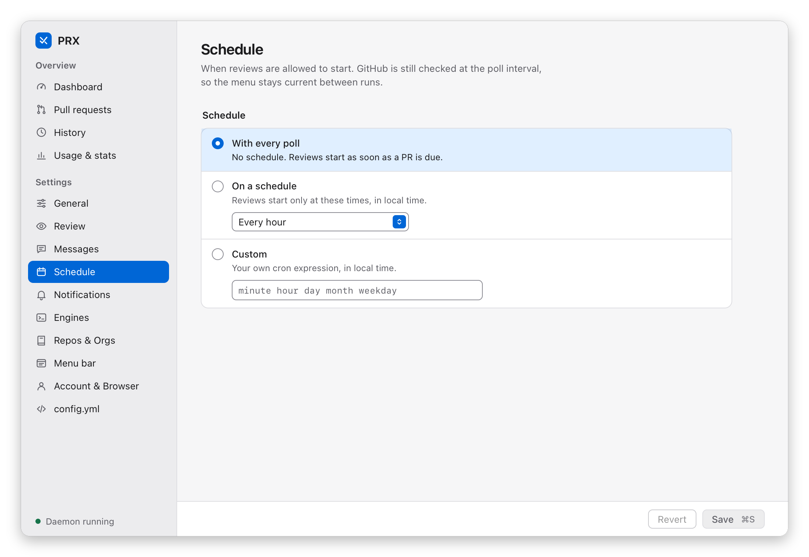

# Review schedule

`schedule` is a standard 5-field cron expression — `minute hour day-of-month month day-of-week`,
Sunday = `0` or `7`, names like `MON-FRI` allowed — or `@hourly` / `@daily` / `@weekly` /
`@monthly` / `@yearly`, evaluated in **local time** and validated when the config loads. It gates
*review enqueueing* only: state polling keeps running on `poll_interval_minutes` so the menu stays
fresh, and at each tick the usual gates still decide what is due (cooldowns, skip rules, review
mode). A repo first seen with a schedule waits for its next tick; it never reviews on sight.

In PRX.app the same setting is on the *Schedule* page:



```yaml
defaults:
  schedule: "0 9-18 * * MON-FRI"   # hourly during working hours
repos:
  - name: acme/api
    schedule: "0 */2 * * *"        # every two hours
```

Precedence: repo `schedule` > org `schedule` > `defaults.schedule`; unset everywhere keeps the
interval cadence (every successful poll enqueues whatever is due). Explicit human requests are not
deferred: `prx review org/repo#42` and the menu's *Re-review now* run right away (cooldowns
bypassed as always), and `prx review --all` enqueues what is due now. *Check GitHub now* /
`prx review-now` only polls early — a scheduled repo still waits for its tick.
